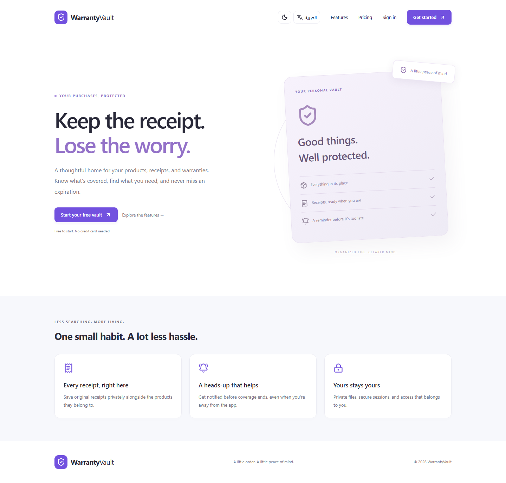

# WarrantyVault

A place to keep product records, private receipts and warranty dates together, with reminders before coverage expires.



[Arabic mobile view](docs/screenshots/mobile-ar.png) · [Actual OCR review](docs/screenshots/scanner.png) · [Current verification](docs/PORTFOLIO_REVIEW.md) · [Deployment](docs/DEPLOYMENT.md)

Screenshots captured on 2026-10-27 from isolated local test data. OCR examples use labelled synthetic receipts. No verified hosted demo is available.

Arabic/English and light/dark controls are available in the header and Settings. See [display preferences](docs/DISPLAY_PREFERENCES.md).

The [2026-10-25 audit](docs/PROJECT_AUDIT_2026-10-25.md) is historical; current results are recorded separately above.

A working React + NestJS application for private receipts, product records, warranty dates, and scheduled reminders. PostgreSQL is the source of truth; the UI has no fake API data. Billing displays the current plan and usage; purchasing is intentionally unavailable.

The **Scan Receipt** flow uses local, free PaddleOCR for Arabic/English images and PDFs, with editable review before saving. See [local OCR setup, testing and limitations](docs/LOCAL_OCR.md).

## Quick start

Requirements: Node.js 24 LTS, npm, and Docker Desktop with its Linux engine running.

```sh
npm ci
```

Copy `.env.example` to `apps/api/.env`. Replace `JWT_SECRET` with a random value of at least 32 characters. Generate one with `node -e "console.log(require('crypto').randomBytes(48).toString('hex'))"`. Never commit this file.

```sh
docker compose up -d db mail
npm run db:generate
npm run db:migrate
npm run db:seed
npm run dev
```

- Application: http://localhost:4173
- API health: http://localhost:3100/api/health
- Swagger API docs (development): http://localhost:3100/api/docs
- Docker PostgreSQL: localhost:15433 (container port remains 5432; Windows PostgreSQL can keep port 15432)
- Mailpit SMTP: localhost:1025; inbox: http://localhost:8025

Register your own account. The seed creates categories and Free/Premium plans, **not** a shared account or password. A local operator can provision an Owner account with a dedicated statistics and user-directory dashboard; see [Owner setup and access](docs/OWNER_DASHBOARD.md). The Free plan allows 5 products and 50 MiB of files. Premium is not purchasable; its database plan has a 10,000-product fair-use ceiling and 5 GiB quota.

Default `MAIL_DRIVER=file` writes email messages to `.data/mail/*.json`; open the `text` link in the browser to verify email or reset a password. For a browser inbox, set `MAIL_DRIVER=smtp`, `SMTP_HOST=localhost`, `SMTP_PORT=1025`, and `SMTP_SECURE=false` in `apps/api/.env`, then restart the API. No email is sent externally by the default adapter. Local receipts live under `.data/receipts` outside the served web directory.

`npm run dev` compiles the API before starting it. After editing backend TypeScript, run `npm run build -w apps/api`; Node watch reloads the compiled output. Vite reloads frontend changes automatically.

On Windows, stop the API before regenerating Prisma: the running process locks the query-engine DLL. Then run `npm run db:generate` and restart it.

### Windows without Docker

If PostgreSQL 18 is already installed, `node scripts/native-db.mjs` starts an isolated development cluster on the port from `apps/api/.env`. It uses `%LOCALAPPDATA%/WarrantyVault/postgres`, an ASCII path outside OneDrive, and does not modify your existing PostgreSQL service. Set `PG_BIN` if the binaries are installed elsewhere. Run migration and seed commands above, then `npm run dev`. Use `node scripts/native-db.mjs --stop` to stop this cluster before switching back to Docker on the same port. The native cluster and Docker volume are separate databases. Keep the default file mail adapter for this mode.

The current Docker configuration uses host port 15433. An existing native cluster can remain on 15432. To use that native cluster instead, set your local `DATABASE_URL` to 15432 and restart the API; do not run the native fallback on Docker's port.

## Project layout

```text
apps/api/src/          Nest modules: auth, products, storage, reminders, users
apps/api/prisma/       normalized schema, SQL migration, reference-data seed
apps/web/src/          React routes, forms, query client, shadcn-style Radix UI primitives
apps/web/public/       PWA icons
packages/shared/      shared domain vocabulary
tests/e2e/            Playwright desktop and mobile flows
docs/                 deployment, security, and implementation record
```

## Available behavior

- Registration, login/logout, HTTP-only JWT cookies, refresh rotation with family reuse detection, email verification, reset/change password, profile updates, account deletion.
- Product CRUD, category/search/status filters, pagination, sorting, manual expiration overrides, month-end clamping, server-calculated status and progress.
- Multiple private receipts and product images. File-content signatures are checked for JPEG, PNG, WEBP, PDF; default maximum 10 MiB. Random storage keys, ownership checks, quota serialization, and short-lived signed access links.
- Dashboard counts, recent products, upcoming expirations, category chart, useful empty states.
- Reminders every five minutes independently of browser activity. Persistent delivery jobs, retry backoff, leases, in-app messages, email preferences, unread state, delivery history.
- Responsive sidebar/mobile navigation, light/dark themes, accessible labeled forms, Radix confirmation dialogs, toast feedback, error/loading/empty states.
- Installable PWA with PNG icons and an app-shell-only service worker. API data and receipt files are never put into the service worker cache. Private data requires an online connection.

## Dates and reminders

Purchases and expirations are calendar dates stored as PostgreSQL `DATE`. All date arithmetic uses UTC; coverage includes the expiration day. January 31 + one month clamps to February 28/29. The default expiring-soon threshold is 30 days, configurable with `EXPIRING_SOON_DAYS`.

The scheduler runs inside the continuously running API process. It creates one job per product/expiration/day threshold, catches up missed thresholds for products that already existed on the due date, and does not send stale reminders after expiration. New products do not receive historical threshold reminders. Expiration changes produce a new reminder schedule; pending jobs for the old expiration are skipped. Email requires a verified address. In-app notifications remain available without verification.

Retries use exponential backoff with a maximum of eight attempts. The UI displays failed attempts in delivery history. A 15-minute lease recovers interrupted workers. Database uniqueness prevents duplicate jobs and in-app notifications. SMTP is **at least once**: a crash after the provider accepts a message and before the transaction records success can cause repeat delivery. A stable Message-ID is supplied; exactly-once delivery requires a provider with idempotency support.

## Checks

Run against a dedicated development/test database, never a live production database. Integration tests create and remove test accounts and temporarily modify a plan quota. Do not run them alongside real users.

```sh
npm run typecheck
npm run lint
npm test
npm run test:integration
npx playwright install chromium
npm run test:e2e
npm run build
npm audit
```

Playwright starts the API and Vite if needed, runs desktop and Pixel 7 viewport flows, and saves screenshots/traces in ignored `test-results/`. Integration tests use a real PostgreSQL database and the file email/storage adapters. Ensure those adapters are selected for the integration suite.

## Docker and deployment

After initial migrations and seeding, `docker compose --profile app up --build -d` runs the API and Nginx frontend with development database/mail services. Stop local processes on ports 3100 and 4173 first. The development Compose setup is not a production security configuration.

See [deployment guide](docs/DEPLOYMENT.md), [security model](docs/SECURITY.md), and [implementation/check record](docs/IMPLEMENTATION.md). Production requires HTTPS, PostgreSQL, a private S3-compatible bucket, SMTP, backups, and a continuously running API process. There is no payment gateway or external AI dependency.

## Portfolio / CV description

> Bilingual warranty and receipt management application built with React, TypeScript, NestJS, Prisma and PostgreSQL, featuring private document uploads, warranty calculations, scheduled reminders and a local OCR review workflow.

## Current deployment boundary

Manual product/receipt workflows support the documented S3/SMTP production configuration. The OCR scanner currently saves only to local storage, while production requires S3, so do not advertise the scanning workflow as production-ready. Current verification covers local adapters, actual local OCR and Chromium desktop/mobile; cloud S3/SMTP and HTTPS hosting remain unverified.
